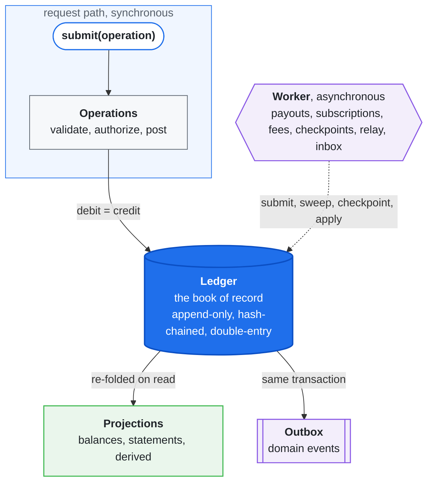

# economy-lab

A provably-solvent credits economy on one double-entry ledger.

[](https://github.com/pwngh/economy-lab/actions/workflows/ci.yml)
[](test/manifest.test.ts)


**On this page**

- [Highlights](#highlights)
- [Quick start](#quick-start)
- [Architecture](#architecture)
- [Guarantees](#guarantees)
- [Ecosystem](#ecosystem)
- [Run it](#run-it)
- [Performance](#performance)
- [Documentation](#documentation)

---

> Read the full documentation at [economy-lab-docs.pages.dev](https://economy-lab-docs.pages.dev/economy/), or try the [live console](https://economy-lab-docs.pages.dev/console/).

## Highlights

- **Zero runtime dependencies** — pure TypeScript. The whole economy runs in memory.
- **Provably solvent** — `read.health()` snapshots every invariant; `proveEconomy` re-derives them from the log.
- **Tamper-evident** — every balance folds from an append-only, hash-chained log under signed Merkle checkpoints.
- **Three ledger stores, one suite** — memory, PostgreSQL and MySQL all pass [`@pwngh/economy-conformance`](packages/conformance). Redis passes the Cache suite, Amazon SQS the Dispatcher suite.
- **A "no" is a return value** — `submit` returns an `Outcome` and never throws for a rejection.
- **Supervisor built in** — `./supervisor` watches twelve incident signatures and writes a hash-chained audit trail. Leaving it out is the off switch.

## Quick start

Build an `Economy`, drive it through a single `submit`, and read derived state through `read`.
`boot()` with no arguments wires a complete in-memory build — the store, a dev signer, a dev
rate table, a flat fee policy, an in-memory processor, and a worker — so there is nothing to
configure:

```ts
import { boot, topUp, toAmount, spendable } from '@pwngh/economy-lab';

const { economy, worker } = await boot();

// Credit a wallet after a card charge clears.
const outcome = await economy.submit(
  topUp({
    idempotencyKey: 'ord_ada_1',
    actor: { kind: 'system', service: 'payments' },
    userId: 'usr_ada',
    amount: toAmount('CREDIT', 5_000n),
    source: 'card',
  }),
);
outcome.status; // 'committed'

const balance = await economy.read.balance(spendable('usr_ada'));
balance.minor; // 5_000n — 50.00 CREDIT in minor units

await worker?.sweep(); // payouts, fees, checkpoints — one background pass

const report = await economy.read.health(); // every solvency & integrity invariant
report.conserved; // true

await economy.close(); // releases every port in the bag that holds one — pool, cache, client
```

## Architecture



The same logic runs in-memory and on PostgreSQL or MySQL through **engines** (databases that
enforce the invariants natively) and **adapters** (cache and event transports). Each port has its
own conformance suite, and every implementation passes it.

## Guarantees

| Capability                   | Where                                                                                                                  | What it guarantees                                                                                                                        |
| ---------------------------- | ---------------------------------------------------------------------------------------------------------------------- | ----------------------------------------------------------------------------------------------------------------------------------------- |
| Double-entry ledger          | [ledger.ts](src/ledger.ts)                                                                                             | A posting is rejected unless its debit and credit lines net to zero per currency; a balance is the sum of its lines.                      |
| Tamper-evident history       | [chain.ts](src/chain.ts), [integrity.ts](src/integrity.ts)                                                             | Each posting is hash-chained per account; a signed Merkle checkpoint anchors the whole ledger; `proveChain` locates any altered entry.    |
| Idempotent requests + outbox | [economy.ts](src/economy.ts), [worker/relay.ts](src/worker/relay.ts)                                                   | A retried request runs once: key, postings, and outbound event all commit in one transaction; duplicates replay.                          |
| Marketplace + fee policy     | [operations/spend.ts](src/operations/spend.ts), [pricing.ts](src/pricing.ts)                                           | A sale charges the buyer and pays the sellers in one balanced transaction; shares sum to 10,000 basis points; the fee is injected policy. |
| Payout saga + retries        | [operations/requestPayout.ts](src/operations/requestPayout.ts), [worker/payouts.ts](src/worker/payouts.ts)             | The worker submits a payout. The settlement webhook settles it once, deduped by event id. A stuck payout re-drives, then reverses.        |
| Recurring subscriptions      | [operations/subscribe.ts](src/operations/subscribe.ts), [worker/subscriptions.ts](src/worker/subscriptions.ts)         | Each period bills once; an underfunded renewal lapses instead of overdrawing.                                                             |
| Refunds & clawback           | [operations/refund.ts](src/operations/refund.ts), [operations/clawback.ts](src/operations/clawback.ts)                 | A reversal restores each account the sale touched, booking any uncollectable remainder to a receivable.                                   |
| Settlement maturity gate     | [maturity.ts](src/maturity.ts)                                                                                         | Payouts release only funds settled past the chargeback window; fresh credits are held back until they mature.                             |
| Spend-velocity risk gate     | [trust.ts](src/trust.ts)                                                                                               | `trust.ts` sums spend over the configured window and refuses a spend past the limit before any posting.                                   |
| Three ledger stores          | [adapters/memory.ts](src/adapters/memory.ts), [packages/postgres](packages/postgres), [packages/mysql](packages/mysql) | The same logic runs in-memory and on PostgreSQL or MySQL. Each port has its own conformance suite.                                        |

`make prove` and `make fuzz` attack these invariants after every operation and across every backend.

## Ecosystem

One sibling package composes around the ledger at runtime, behind the `Processor` port — the lab runs unchanged without it. See [the packages](https://economy-lab-docs.pages.dev/economy/ports/packages/) for where everything plugs in.

- **[@pwngh/economy-edge](https://github.com/pwngh/economy-edge)** — a Tilia payout rail behind the `Processor` port.

One more package serves the ledger without composing as a sibling. **[@pwngh/taskq](https://github.com/pwngh/taskq)** is an optional relay backend: with `TASKQ=1` the outbox relay rides taskq's task table beside the ledger, one at-least-once task per event, keyed by event id.

## Run it

```bash
make dev         # local HTTP server — in-memory, dev tokens; zero setup
make start       # HTTP service against the configured environment
make worker      # background sweep loop
make test        # the full suite, zero infra, all in-memory
make check       # every gate, as 28 named steps in four tiers (node scripts/check.ts <tier> runs one)
make demo        # the same local server, seeded with a top-up, a spend, and a rejection
make demo-ops    # supervisor closed loop: a stuck payout is detected, swept, verified
make prove       # randomized invariant proof; exits non-zero on any leak or drift
make fuzz        # cross-backend differential — every backend must produce identical results
make backup      # data-only dump of every configured engine into backups/
make restore-drill # restore the newest dump into a scratch namespace and prove it
make db-clean    # drop the orphaned throwaway namespaces a killed run left behind
```

Those verbs run the `economy` bin over this repository's own module at `economy/app.ts` — the same
entry a project scaffolded by `create-economy` gets, and what the Docker image runs. The process is
an HTTP service (`POST /submit`, `POST /webhooks/:provider`, plus `/healthz` and `/readyz`) and a
background worker (sixteen sweeps on an interval). Every backend is picked by an environment
variable: `DATABASE_URL` selects PostgreSQL or MySQL, `REDIS_URL` the
cache. `SUPERVISOR=1` composes the supervisor around the worker, and
[Ops & runbooks](https://economy-lab-docs.pages.dev/economy/ops/) holds one runbook per incident signature.

## Performance

`make bench` measures `submit` throughput per backend and integrity cost as the ledger grows. In
memory it runs tens of thousands of submits per second; on Postgres or MySQL each submit is its own
transaction, so throughput is commit-bound (hundreds per second). Those are the general-path
numbers: where a workload allows it, instance netting and the entitlement bitset remove the
transaction and the round-trip respectively.
See [Performance](https://economy-lab-docs.pages.dev/economy/reference/performance/) for
the measured tables and how to read them.

## Apps

- [apps/console](apps/console) — a demo admin UI driven by the live engine: accounts, the ledger
  feed, the payout board, and an integrity page, with a simulation panel to advance time and run
  the background jobs. [Try it live](https://economy-lab-docs.pages.dev/console/).
- [apps/docs](apps/docs) — the source of the [documentation site](https://economy-lab-docs.pages.dev/economy/).

## Documentation

- [The Economy surface](https://economy-lab-docs.pages.dev/economy/reference/the-economy/) — the whole `submit` / `read` / `close` API.
- [The proof](https://economy-lab-docs.pages.dev/economy/concepts/the-proof/) — what the randomized prover and the cross-backend differential each attack.
- [HTTP service](https://economy-lab-docs.pages.dev/economy/reference/http-service/) — `POST /submit`, webhooks, and health checks.
- [Background worker](https://economy-lab-docs.pages.dev/economy/reference/background-worker/) — the sixteen sweeps and how they run.
- [Configuration](https://economy-lab-docs.pages.dev/economy/reference/configuration/) — every environment variable and backend selector.

## License

MIT — see [LICENSE.md](LICENSE.md).
